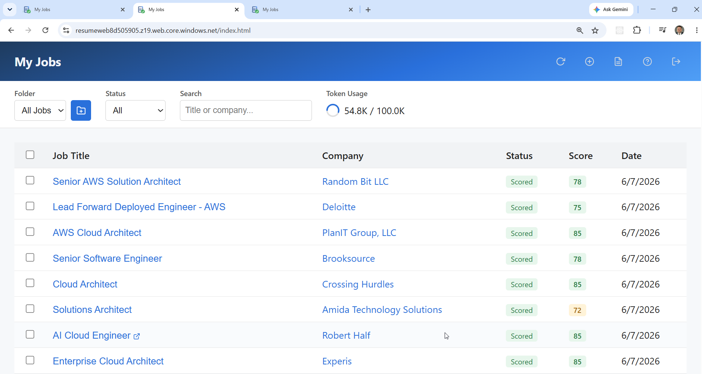

# Resume Scorer on Azure: Entra External ID, Functions, Service Bus and Azure OpenAI

A serverless **resume scoring** app. Users sign in with **Microsoft Entra
External ID**, store one or more resumes, and submit job postings as a URL,
pasted text, or LinkedIn job IDs. HTTP functions in a **Flex Consumption
Function App** queue each job on **Service Bus**, and a queue-triggered
function in the same app fetches the posting, has **gpt-4o on Azure OpenAI**
extract the job details and score the resume from 0 to 100, and writes an
analysis split into strengths and weaknesses. Data lives in **Cosmos DB** and
**Blob Storage**, and a vanilla JavaScript single-page app on a storage
static website ties it together.



| Piece | Where | Role |
|---|---|---|
| **resume-app** | Entra External ID tenant | SPA app registration (authorization code with PKCE); `apply.sh` adds it to your sign-up/sign-in user flow |
| **resume-func-&lt;hex&gt;** | `resume-app-rg`, Central US | Function App on the `FC1` plan, Python 3.11, up to 10 instances of 2 GB; anonymous HTTP functions that validate the bearer token themselves, plus `resume_scoring_worker`; system-assigned managed identity; CORS allows only the web origin |
| **resume-aoai-&lt;hex&gt;** | Azure OpenAI, S0 | deployment `gpt-4o` (model version `2024-11-20`), GlobalStandard, 100K tokens per minute |
| **sb-resume-&lt;hex&gt;** | Service Bus, Standard | local (key) auth disabled; queue `resume-scoring-jobs`: 5 min lock, 5 delivery attempts, 90 day TTL, dead-letters expired messages |
| **cosmos-resume-&lt;hex&gt;** | Cosmos DB | database `resume-app` with `resumes`, `jobs`, `folders` and `users`, each partitioned on `/owner` at 400 RU/s |
| **resumemedia&lt;hex&gt;** | Storage | private containers `resumes` and `jobs`: resume text, job descriptions, analyses and attachments |
| **resumeweb&lt;hex&gt;** | Storage | static website with the SPA and a generated `js/config.js` |
| **resumefunc&lt;hex&gt;** / **resume-ai-&lt;hex&gt;** | `resume-app-rg` | deployment package storage, and Application Insights |

## Architecture

<picture>
  <source media="(prefers-color-scheme: dark)" srcset="architecture-dark.svg">
  
</picture>

Regenerate with `python3 make_diagram.py`.

- **`01-backend/`**: the resource group, the Entra app registration (applied
  with a service principal in the External tenant), Azure OpenAI and its
  deployment, Service Bus, Cosmos DB and both storage accounts.
- **`02-functions/`**: the Function App, its storage, plan and Application
  Insights, its role assignments, and all the functions in
  `code/function_app.py`.
- **`03-webapp/`**: the SPA in `site/`, uploaded to the static website.
- **`aoai-config.sh`**: the model deployment name, sourced by `apply.sh` and
  `destroy.sh`.

No keys are stored in app settings: the app's managed identity has Service
Bus Data Sender and Receiver on the queue, Storage Blob Data Contributor on
the media account, Cognitive Services OpenAI User on Azure OpenAI, and a
custom Cosmos DB data role.

## How a job is scored

1. The browser signs in through the user flow and sends the access token as
   a bearer token. Each function checks it against the tenant's
   `ciamlogin.com` keys with the `resume-app` client ID as audience, and
   uses the `sub` claim as the owner.
2. On first sign-in the page calls `POST /api/register`, which creates the
   user record, up to a cap of 100 users.
3. `POST /api/jobs` checks the user is under their token limit, saves the
   job, and sends it to the queue. LinkedIn job IDs become one job each.
4. The worker fetches the URL (or uses the pasted text), strips it to
   visible text with BeautifulSoup, and calls gpt-4o once to extract the
   title, company and other fields and again to score the resume. It stores
   the analysis in Blob Storage, marks the job `Scored`, and adds the tokens
   to the user's total.
5. If anything fails, it marks the job `Failed` with a message and raises,
   so Service Bus redelivers the message, up to 5 times.

The default limit is 100,000 tokens per user for the account's lifetime.

## API

Every route is under `/api` and needs `Authorization: Bearer <access
token>`; everything is scoped to the token's user.

| Area | Routes |
|---|---|
| Resumes | `POST /resumes`, `GET /resumes`, `GET`/`PUT`/`DELETE /resumes/{resume_id}` |
| Jobs | `POST /jobs` (URL, raw text or LinkedIn IDs), `GET /jobs`, `GET`/`DELETE /jobs/{job_id}`, `PATCH /jobs/{job_id}/notes`, `PATCH /jobs/{job_id}/folder` |
| Attachments | `GET`/`POST /jobs/{job_id}/attachments`, `GET`/`DELETE /jobs/{job_id}/attachments/{attachment_id}`; base64 JSON, up to 10 MB each and 5 per job |
| Folders | `POST /folders`, `GET /folders`, `DELETE /folders/{folder_id}` (its jobs become unassigned) |
| Account | `POST /register`, `GET /usage` |

## Prerequisites

* [An Azure Account](https://portal.azure.com/) with Azure OpenAI quota for
  gpt-4o GlobalStandard in Central US
* [Install AZ CLI](https://learn.microsoft.com/en-us/cli/azure/install-azure-cli)
* [Install Terraform](https://developer.hashicorp.com/terraform/install)
* [Install jq](https://jqlang.github.io/jq/download/), `zip` and `envsubst`
* A service principal with **Contributor** and **User Access
  Administrator** on the subscription (Terraform creates role assignments)
* A **Microsoft Entra External ID tenant** with a sign-up/sign-in user flow,
  and a service principal in that tenant with the Microsoft Graph
  application permissions `Application.ReadWrite.All` and
  `EventListener.ReadWrite.All` (admin consent granted); see
  [azure-cartoonify](https://github.com/mamonaco1973/azure-cartoonify#one-time-entra-external-id-setup)
  for the portal steps

```bash
# Subscription
export ARM_CLIENT_ID="..."
export ARM_CLIENT_SECRET="..."
export ARM_TENANT_ID="..."
export ARM_SUBSCRIPTION_ID="..."

# Entra External ID
export ENTRA_TENANT_ID="..."
export ENTRA_TENANT_NAME="<external-tenant-name>.onmicrosoft.com"
export ENTRA_SP_CLIENT_ID="..."
export ENTRA_SP_CLIENT_SECRET="..."
export ENTRA_USER_FLOW_NAME="..."
```

If this is your first time following along, we recommend starting with this
video: [Azure + Terraform: Easy Setup](https://youtu.be/wwi3kVgYNOk).

## Deploy

```bash
git clone https://github.com/mamonaco1973/azure-resume-app.git
cd azure-resume-app
./apply.sh
```

`apply.sh`:

1. Applies **`01-backend`**.
2. Gets a Microsoft Graph token as the External tenant's service principal
   and adds `resume-app` to the user flow, retrying while the new app
   propagates.
3. Applies **`02-functions`**, zips `02-functions/code` and deploys it with
   a remote build, retrying if the deployment fails.
4. Renders `js/config.js` (API URL, client ID, authority) and applies
   **`03-webapp`**.

It ends by running `validate.sh`, which prints the URL:

```
=================================================================================
  Resume Scorer — Deployment validated!
=================================================================================
  Web : https://resumeweb<hex>.z19.web.core.windows.net/index.html
=================================================================================
```

To use another model, change `AOAI_MODEL_DEPLOYMENT` in `aoai-config.sh`;
the deployment in `01-backend/aoai.tf` also names the model and version.

## Try it

1. Open the **Web** URL, sign in, and create an account in the user flow
   with your email.
2. Open **Manage Resumes**, create a resume, and paste in its text.
3. Choose **Score New Job**, pick the resume and optionally a folder, and
   give the job as a URL, pasted description, or LinkedIn job IDs (one per
   line). The dashboard refreshes while jobs are pending.
4. Once a job shows **Scored**, open it to read the score, the strengths and
   weaknesses, and the extracted details. Add notes, move it to a folder, or
   attach files.

## Teardown

```bash
./destroy.sh
```

## Notes

- **Lab only.** Anyone can sign up through the user flow, up to the
  100-user cap.
- Nothing expires on its own: the Cosmos DB containers have TTL enabled but
  no items set one, and the media account has no lifecycle rules.
  `JOB_RETENTION_DAYS = 90` in `function_app.py` isn't used.
- Because a failed job is redelivered, a job that fails after one model call
  can be charged for more tokens than it used once.
- The token check verifies the signature, audience and expiry, but not the
  issuer.
